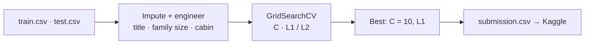

<h1 align="center">🚢 Titanic Survival Prediction</h1>

<p align="center">Kaggle's classic: who survived? Logistic Regression, an ANN and a CNN, scored on the public leaderboard.</p>

<p align="center">
  
  
  
</p>

> **Partial upload.** Only the Logistic Regression notebook has code. `2(CNN).ipynb` is an empty
> (0-byte) file, and the ANN notebook isn't committed. [Details →](#status--known-issues)

## Results

| Model | Train acc. | Validation acc. | Kaggle public score | Code in repo |
|---|---|---|---|---|
| **Logistic Regression** | — | 81.75 % (CV) · 85.5 % (hold-out) | **0.77272** | ✅ `main.ipynb` |
| ANN | 89.47 % | 83.80 % | 0.75358 | ❌ |
| CNN | 84.97 % | 80.45 % | 0.7679 | ❌ empty file |

The simplest model generalises best. The neural nets overfit 891 rows, and their train–test gap shows it.

## How it works



## Run it

```bash
pip install numpy pandas scikit-learn matplotlib seaborn
kaggle competitions download -c titanic      # or download from kaggle.com
jupyter notebook main.ipynb
```

Change the `D:\CurrentWork\TitanicSurvival\Data\` paths to where you saved the CSVs.

## Status & known issues

| Issue | Effect |
|---|---|
| `2(CNN).ipynb` is 0 bytes; no ANN notebook | ANN and CNN results can't be reproduced |
| Paths hard-coded to `D:\` | Edit before running |
| Neural nets on 891 tabular rows | Too little data and no spatial structure for a CNN; both overfit |

## Roadmap

- [ ] Commit the ANN and CNN notebooks (or drop their rows)
- [ ] Random Forest / gradient boosting and a soft-voting ensemble
